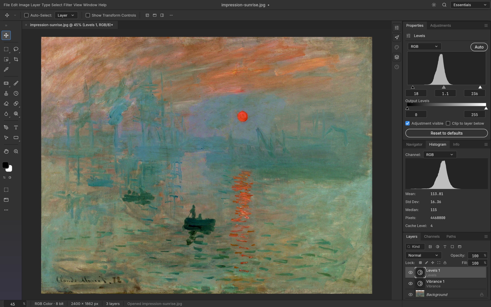
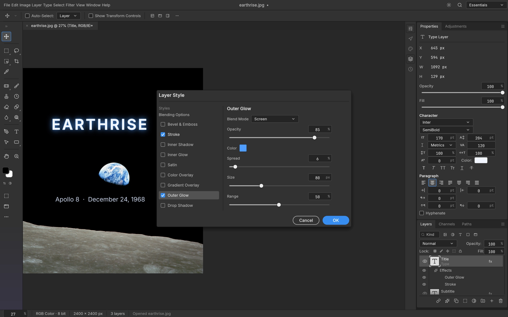
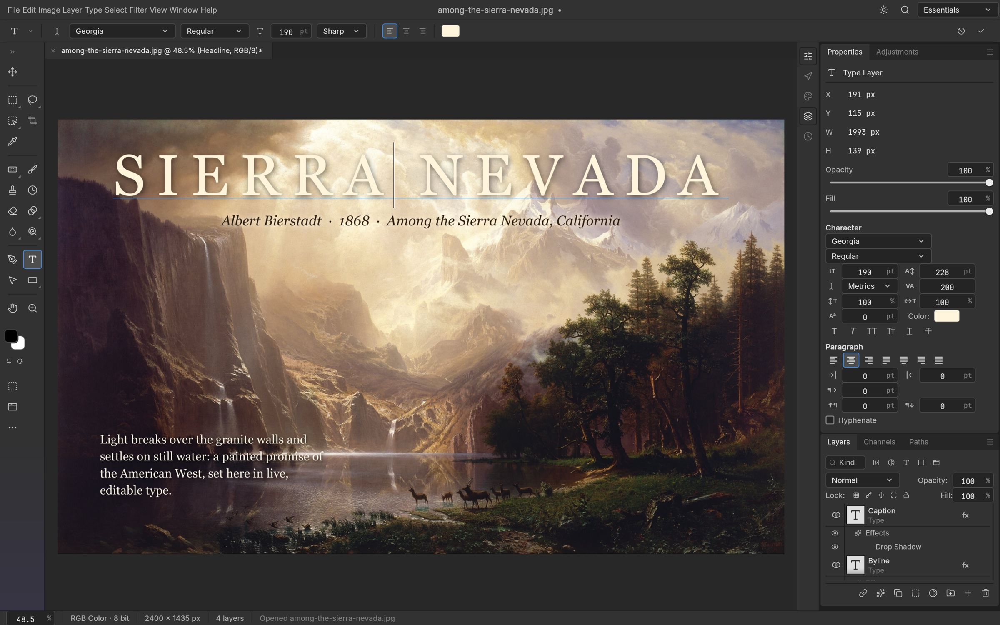
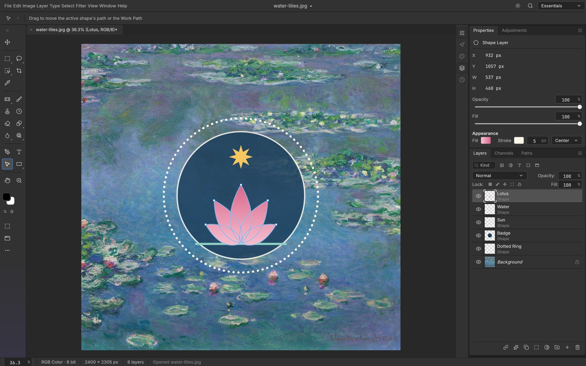

<p align="center">
  <a href="https://getartcraft.com/">
    <picture>
      <source media="(prefers-color-scheme: dark)" srcset="docs/brand/artcraft-logo-white.svg">
      
    </picture>
  </a>
</p>

<h1 align="center">PhotoCraft Pro</h1>

<p align="center">
  <b>Professional, native image editing for macOS &mdash; rebuilt in pure Rust.</b><br>
  An enhanced, Mac-focused edition of PhotoCraft featuring deep obsidian UI, polished Photoshop 2026 aesthetics,<br>
  native macOS AppKit menu bar, Apple Silicon &amp; Metal acceleration, layers, masks, adjustment layers, and real PSD files.<br>
  Open source, offline, private, and yours.
</p>

<p align="center">
  
  
  
  
  
  
</p>

<p align="center">
  <a href="https://discord.gg/artcraft"></a>
</p>

<p align="center">
  <a href="#built-specifically-for-macos"><b>macOS Features</b></a> ·
  <a href="#credits-and-acknowledgments"><b>Credits &amp; Original Creators</b></a> ·
  <a href="https://getartcraft.com/apps/photocraft">PhotoCraft Upstream</a> ·
  <a href="https://getartcraft.com/">ArtCraft</a> ·
  <a href="https://getartcraft.com/apps">All Crafting Apps</a>
</p>

<br>

<p align="center">
  
  <br>
  <sub>A caption card with a drop shadow, live type, and Vibrance and Curves adjustment layers, with the Curves editor open.<br>
  <i>The Great Wave off Kanagawa</i>, Katsushika Hokusai, c. 1831</sub>
</p>

> [!NOTE]
> **Built upon the Crafting Apps ecosystem.** PhotoCraft Pro is an advanced, macOS-dedicated edition of **PhotoCraft**, originally created by the [Storytold](https://github.com/storytold) / [ArtCraft](https://getartcraft.com/) team and community. Full credit and gratitude go to the original creators of PhotoCraft and the sibling Crafting apps. [Read the full credits & acknowledgments below](#credits-and-acknowledgments).

<p align="center">
  <a href="#built-specifically-for-macos">macOS Focus</a> ·
  <a href="#features">Features</a> ·
  <a href="#everything-in-the-box">Everything in the box</a> ·
  <a href="#psd-without-compromise">PSD</a> ·
  <a href="#built-for-agents">Agents</a> ·
  <a href="#under-the-hood">Under the hood</a> ·
  <a href="#credits-and-acknowledgments">Credits</a> ·
  <a href="#the-crafting-apps">Crafting Apps</a> ·
  <a href="#get-started">Get started</a> ·
  <a href="https://discord.gg/artcraft">Discord</a>
</p>

<br>

<table>
  <tr>
    <td width="25%" valign="top">
      <h3>🍎 Built for Mac</h3>
      Native macOS AppKit menu bar, Metal GPU compositor, Apple Silicon optimization, Retina display rendering, and native macOS shortcuts (⌘J, ⇧⌘D, ⌘⌥Z).
    </td>
    <td width="25%" valign="top">
      <h3>⚡ Native and fast</h3>
      A Metal GPU compositor on wgpu, copy-on-write tiles and multithreaded filters. Zero Electron, no web views, instantaneous launch, and ultra-low memory overhead.
    </td>
    <td width="25%" valign="top">
      <h3>🗂️ Real PSD files</h3>
      Open, edit and save layered Photoshop documents. Re-saving keeps the render of 307 of the 309 psd-tools test files.
    </td>
    <td width="25%" valign="top">
      <h3>🤖 Agent-ready</h3>
      Every action is a command, so you can drive the same engine from the UI, the CLI, a JSON control channel or an MCP server.
    </td>
  </tr>
</table>

<br>

## 🍎 Built Specifically for macOS

PhotoCraft Pro is tuned as a dedicated macOS application, honoring Apple design conventions, hardware capabilities, and pro creative workflows:

- **Metal GPU Compositor**: Native wgpu Metal rendering path optimized for Apple Silicon (M1/M2/M3/M4) unified memory and Intel Macs, delivering silky 60/120 fps canvas rendering and zero thermal throttling.
- **Native macOS Menu Bar**: Deep AppKit integration via `muda`, providing a true system menu bar at the top of the display with macOS standard key equivalents (⌘, ⌥, ⇧, ⌃).
- **Precision Pen Tablet Input**: Dedicated macOS AppKit event monitor (`crates/tablet/src/macos.rs`) directly intercepting `NSEvent` streams for Wacom tablets, Apple Pencil (via Sidecar), and styluses with pressure, tilt, and subpixel tracking without dropped packets.
- **Retina & HiDPI Optimization**: Pixel-sharp UI widgets, subpixel font antialiasing, and crisp canvas zooming on Retina and ProMotion displays.
- **Obsidian Dark Aesthetic**: Polished, distraction-free Photoshop 2026 dark obsidian palette (`#18181a` / `#121214`) engineered specifically to match macOS creative workstations.
- **Pure Native Rust**: Zero Electron, zero webview shells, zero JavaScript runtimes. Instant launch, lightweight memory footprint, and complete privacy &mdash; your files never leave your Mac.

## Features

Every screenshot here is the real app at work on public-domain art, rendered offscreen through its control channel.

<table>
  <tr>
    <td width="50%" valign="top">
      
      <br>
      <sub>Levels and Vibrance adjustment layers, with the live Histogram panel.<br><i>Impression, Sunrise</i>, Claude Monet, 1872</sub>
      <h3>Edit without regret</h3>
      Adjustment layers keep every edit live. Stack Levels, Curves, Vibrance, Hue/Saturation and a dozen more, mask them to an area, reorder them, or turn them off, and your original pixels never change.
      <br><br>
      <b>16 adjustment layers</b> that also apply directly to pixels, including Curves with per-channel editing, Levels with a live histogram, Black &amp; White, Channel Mixer, Gradient Map, Photo Filter, Selective Color and Color Lookup (.cube, .3dl, .look). Plus Shadows/Highlights, Replace Color, Match Color, HDR Toning, Desaturate and Equalize.
    </td>
    <td width="50%" valign="top">
      
      <br>
      <sub>Outer Glow and Stroke on a live type layer, in the Layer Style dialog.<br><i>Earthrise</i>, William Anders / NASA, 1968</sub>
      <h3>Styles that sell the shot</h3>
      Drop Shadow, Inner Shadow, Outer and Inner Glow, Bevel &amp; Emboss, Satin, Stroke, and Color, Gradient and Pattern Overlay, live on any layer, including type. Patterns come from a library (built-ins, Edit › Define Pattern, <code>.pat</code> import/export) and PSD <code>Patt</code> blocks.
      <br><br>
      Copy and paste styles between layers, hide all effects at once, and open styles straight from your PSDs, rendered to match Photoshop.
    </td>
  </tr>
  <tr>
    <td width="50%" valign="top">
      
      <br>
      <sub>An elliptical selection becomes the mask of a Hue/Saturation layer, so only the face keeps its color.<br><i>Girl with a Pearl Earring</i>, Johannes Vermeer, c. 1665</sub>
      <h3>Selections that understand your image</h3>
      Marquees, lassos and the Magic Wand for precision; Quick Selection, Object Selection and Select Subject when you want the computer to do the tracing; Select and Mask to refine hair-fine edges.
      <br><br>
      Feather, expand, contract, smooth, grow, reselect. Turn any selection into a layer mask, a vector path or a shape. Smart selection runs on your machine, with no cloud and no account.
    </td>
    <td width="50%" valign="top">
      
      <br>
      <sub>A headline edited in place, with a byline and a paragraph of body text.<br><i>Among the Sierra Nevada, California</i>, Albert Bierstadt, 1868</sub>
      <h3>Type that sets beautifully</h3>
      Point and paragraph text, edited right on the canvas, with full Character and Paragraph controls: font, weight, size, leading, tracking, alignment and colour. The <a href="docs/color-picker.md">full Type Color Picker</a> also supports screen sampling with a pixel loupe.
      <br><br>
      Type layers stay editable, take layer styles, and round-trip through PSD.
    </td>
  </tr>
  <tr>
    <td width="50%" valign="top">
      
      <br>
      <sub>A badge made of shape layers: a gradient-filled lotus, a star and a dotted ring.<br><i>Water Lilies</i>, Claude Monet, 1906</sub>
      <h3>Pixel-perfect vectors</h3>
      Rectangle, Ellipse, Triangle, Polygon, Line and the Pen, Freeform Pen and Curvature Pen tools, with resolution-independent shape layers, gradient fills, and dashed, aligned strokes.
      <br><br>
      Combine shapes (unite, subtract, intersect, exclude), keep paths in the Paths panel, use them as vector masks, or stroke and fill them. 116 of 116 shape layers in our PSD corpus match Photoshop's pixels.
    </td>
    <td width="50%" valign="top">
      
      <br>
      <sub>Twirl previews live on the canvas, only inside the selection.<br><i>The Starry Night</i>, Vincent van Gogh, 1889</sub>
      <h3>See it before you commit</h3>
      Every filter dialog previews live on the canvas, through your selection. Blurs (Gaussian, Box, Motion, Radial, Surface, Smart, Lens, Shape, and the Blur Gallery: Tilt-Shift, Iris, Field, Spin, Path), sharpening, Reduce Noise, distortions (Twirl, Wave, Ripple, Displace, Shear, Zig Zag…), Pixelate, Stylize (Oil Paint, Wind, Extrude…), Render (Clouds, Fibers, Lens Flare, Lighting Effects) and more.
      <br><br>
      Run filters on a smart object and they stay editable: change, hide, reorder or mask them at any time.
      <br><br>
      Large-radius blurs use running-sum box passes across all cores: a radius-180 Gaussian on 3.6 MP takes under a second.
    </td>
  </tr>
  <tr>
    <td width="50%" valign="top">
      
      <br>
      <sub>Free Transform on a rotated print, with every step listed in History.<br><i>The Tetons and the Snake River</i>, Ansel Adams, 1942</sub>
      <h3>Shape it any way you like</h3>
      Free Transform with scale, rotate, skew, distort and perspective; exact 90° and 180° rotations and flips; Transform Again. Layers, type, shapes, masks and selections all transform together.
      <br><br>
      Full history, Toggle Last State and the History Brush mean every step can be undone, even one brush stroke at a time.
    </td>
    <td width="50%" valign="top">
      
      <br>
      <sub>Export As in the light theme, with a preview and a file-size estimate.<br><i>The Kiss</i>, Gustav Klimt, 1907–1908</sub>
      <h3>Ship it anywhere</h3>
      Export As with format, quality, transparency and scale, plus a preview and an instant file-size estimate. Quick Export to PNG in one click.
      <br><br>
      Choose a dark Pro theme, the airy Studio themes, or a Classic look.
    </td>
  </tr>
</table>

<br>

## Everything in the box

<table>
  <tr>
    <td width="33%" valign="top">
      <h4>🧰 67 tools</h4>
      Move · Artboard · Rectangular and Elliptical Marquee · Single Row Marquee · Single Column Marquee · Lasso · Polygonal Lasso · Magnetic Lasso · Object Selection · Quick Selection · Magic Wand · Crop · Perspective Crop · Slice · Slice Select · Frame · Eyedropper · Color Sampler · Ruler · Note · Count · Remove · Spot Healing Brush · Healing Brush · Patch · Content-Aware Move · Red Eye · Brush · Pencil · Mixer Brush · Color Replacement · Clone Stamp · Pattern Stamp · History Brush · Eraser · Background Eraser · Magic Eraser · Gradient · Paint Bucket · Blur · Sharpen · Smudge · Dodge · Burn · Sponge · Pen · Freeform Pen · Curvature Pen · Add Anchor Point · Delete Anchor Point · Convert Point · Horizontal and Vertical Type · Horizontal and Vertical Type Mask · Path Selection · Direct Selection · Rectangle · Ellipse · Triangle · Polygon · Line · Custom Shape · Hand · Rotate View · Zoom
    </td>
    <td width="33%" valign="top">
      <h4>🖌️ A real brush engine</h4>
      Shape Dynamics, Scattering, Texture, Dual Brush, Color Dynamics, Transfer, Brush Pose, Wet Edges, Build-up and Smoothing (including Pulled String), driven by pen pressure, tilt, rotation and direction. Brush presets, Define Brush from Selection, and deterministic, replayable strokes.
    </td>
    <td width="33%" valign="top">
      <h4>🗃️ Layers, done properly</h4>
      Groups, clipping masks, pixel and vector masks, fill layers (solid, gradient and pattern), adjustment layers, live smart objects with smart filters and lossless transforms and warps, multi-layer selection with align, distribute and link, alpha channels and Quick Mask, 27 Photoshop blend modes plus six Paint.NET variants, opacity and fill, locks, colour labels, a layer kind filter, merge, flatten, rasterize, Layer via Copy/Cut, Paste Into.
    </td>
  </tr>
  <tr>
    <td width="33%" valign="top">
      <h4>🎨 Any colour, any depth</h4>
      RGB, Grayscale, CMYK and Lab documents at 8, 16 and 32 bits per channel. Bit depth and colour model are runtime data, so every tool works at every depth.
      <br><br>
      Real ICC colour management in pure Rust: embedded profiles, Assign and Convert to Profile with all four rendering intents and black point compensation, soft proofing (⌘Y) and Gamut Warning (⇧⌘Y) on the GPU.
    </td>
    <td width="33%" valign="top">
      <h4>🗂️ Formats</h4>
      PSD and PSB, layered TIFF (Photoshop's layer data in the TIFF, read and written in either byte order), <a href="docs/pdn.md">Paint.NET PDN3 (read, with editable layers and all 14 blend modes)</a>, <a href="docs/ora.md">OpenRaster (read and write, with layers, groups and blend modes, for Krita, MyPaint and GIMP)</a>, <a href="docs/kra.md">Krita .kra (read, with paint layers, groups, blend modes and transparency masks)</a>, SVG (opens as shape layers, places as a vector Smart Object), plus flat PNG, JPEG, TIFF, WebP (lossy and lossless), GIF, BMP, TGA, ICO, QOI, PNM, OpenEXR, Radiance HDR and FITS (astronomy images: 8/16-bit and 32-bit float, gray or RGB, header kept), and the native <code>.pcraft</code> format. Flat formats retain the depths they support: PNG keeps 8/16-bit samples, TIFF keeps 8/16-bit and 32-bit float samples, and OpenEXR keeps half/float samples; JPEG, WebP and the other 8-bit formats reduce higher-depth samples with an export warning. See the <a href="crates/codecs/README.md#capability-matrix-default-build">codec capability matrix</a> for each format. HEIC photos from iPhone and Mac are read-only (included in official builds; optional <code>--features heif</code> for source builds). AVIF is write-only with the optional <code>avif</code> build feature; AVIF decoding and JPEG XL are unavailable. Affinity documents (<code>.af</code>, <code>.afdesign</code>, <code>.afphoto</code>, <code>.afpub</code>) open natively, read only, with artboards, layers, vectors, text, images and masks; effects, adjustments and other unsupported parts are listed in a warning, and Affinity export is unavailable.
    </td>
    <td width="33%" valign="top">
      <h4>🪄 The everyday essentials</h4>
      Auto Tone, Contrast and Color · Equalize · Image and Canvas Size · Crop and Trim · Reveal All · Edit › Fill and Stroke · Copy Merged · Paste in Place · guides, rulers, grid and snapping · Actions record and replay · a command palette (⌘F).
    </td>
  </tr>
</table>

<br>

## PSD without compromise

PhotoCraft Pro's PSD support is powered by a standalone, clean-room crate written from Adobe's public specification and tested against a corpus of real-world files.

- **Faithful round trips:** opening and re-saving a document renders the same for 307 of the 309 files in the psd-tools test set and 169 of 170 in our mixed ag-psd/psd-tools set (`crates/io/tests/corpus.rs`; fetch the psd-tools set with `cargo xtask corpus --psd-tools`), and anything we don't model yet (raw blocks, descriptors, extras) is carried over instead of being dropped. A re-saved file is not byte-identical to its source: PhotoCraft Pro rewrites image resources, layer records and the composite. Only the standalone `photocraft-psd` crate, parsing and writing a file without the document model, reproduces every parseable corpus file byte for byte (`crates/psd/tests/corpus.rs`).
- **Pixels that match:** a composite oracle compares our render with Photoshop's own merged image, covering gradient interpolation (Classic, Perceptual and Linear), layer effects, shape strokes, clipping and fill opacity.
- **Large documents:** PSB, 16 and 32-bit files, and CMYK and Lab documents open natively.

## Built for agents

Every menu item, tool and dialog runs a command from one registry of 500+ commands. The UI, the CLI, the JSON control channel and the MCP server all call the same commands, so anything you can click, a script or an AI agent can do too.

```sh
# Headless: open, edit, save
photocraft-cli run wave.psd \
  --cmd filter.sharpen.smartSharpen     --params '{"amount":80}' \
  --cmd layer.newAdjustmentLayer.curves --params '{"points":[[0,0],[64,48],[192,212],[255,255]]}' \
  --out wave-final.png

# Apply one action list to a folder of images
photocraft-cli batch --actions grade.json --in ./raw --out ./graded

# Every subcommand explains itself
photocraft-cli batch --help

# Let an agent drive it over MCP (headless, or bridged to the running app)
photocraft-cli mcp
```

The desktop app also offers an authenticated, loopback-only control channel (`photocraft --control`) for inspecting UI state, driving tools with pointer events, and taking offscreen screenshots. Every image in this README was rendered that way. See [`docs/control-protocol.md`](docs/control-protocol.md).

## Under the hood

- **Engine first:** a pure-data document model and a command engine, with a thin native egui UI on top. Layering is strictly enforced at build time across 24 crates.
- **Metal GPU Compositor:** a high-performance wgpu compositor puts the canvas directly onto Apple Metal for fast, responsive rendering, backed by a reference CPU compositor oracle.
- **Copy-on-write tiles:** 256² sparse tiles make undo instantaneous and huge canvases light, and effect maps are cached per layer state.
- **Cross-platform core:** the same engine compiles to native desktop and WebAssembly.
- **Clean-room:** implemented from public specs and observed behaviour only. No proprietary code, shaders or assets.
- **Tested:** more than 1,700 tests, including PSD round trips, synthetic generators, compositor oracles and multi-depth checks.

## Get started

PhotoCraft Pro is focused on macOS (Apple Silicon M1/M2/M3/M4 & Intel):

```sh
# Clone the repository
git clone https://github.com/storytold/photocraft
cd photocraft

# Run the native macOS desktop app
cargo run --release -p photocraft -- image.psd

# Run workspace tests
cargo test --workspace
```

To build a universal binary for Apple Silicon and Intel Macs:

```sh
cargo build --release --target aarch64-apple-darwin
cargo build --release --target x86_64-apple-darwin
lipo -create -output target/release/photocraft \
  target/aarch64-apple-darwin/release/photocraft \
  target/x86_64-apple-darwin/release/photocraft
```

Japanese fonts for the UI and Type tool come from [craft-fonts](https://github.com/storytold/craft-fonts), an optional build input (desktop release builds always include it). Without it PhotoCraft Pro uses your Mac's system CJK fonts:

```sh
git clone https://github.com/storytold/craft-fonts ../craft-fonts
CRAFT_FONTS_DIR="$PWD/../craft-fonts" cargo run --release -p photocraft
```

New contributors and AI agents: start with [`AGENTS.md`](AGENTS.md), then [`docs/`](docs/).

> [!IMPORTANT]
> **Status:** PhotoCraft Pro is in active pro alpha: much of Photoshop's feature surface exists in some form, but it is continuously evolving. The biggest areas of active development are AI/generative features, typography depth, and plug-in compatibility. Every Photoshop menu item is wired to a command ([`docs/parity-checklist.md`](docs/parity-checklist.md)). The honest, dimension-by-dimension picture and where we're going next are in the [roadmap](ROADMAP.md) and [parity assessment](docs/target-app-parity.md). Expect rough edges, and please file issues (include your macOS version, document size, layer count and a screenshot). You can also join us on [Discord](https://discord.gg/artcraft).

## Downloads

PhotoCraft Pro is distributed as a native macOS application optimized for Apple Silicon (M1/M2/M3/M4) and Intel Macs:

### macOS (Universal DMG & CLI)

| Package | Architecture | Notes |
|---|---|---|
| **PhotoCraft Pro** (`photocraft-<ver>-macos-universal.dmg`) | Apple Silicon + Intel | Native macOS app, drag-and-drop `.app` bundle, signed & notarized |
| **Command-line & Agent Tool** (`photocraft-cli-<ver>-macos-universal.zip`) | Apple Silicon + Intel | Headless CLI, batch processor, and MCP server |

Universal macOS binaries are signed with Apple Developer ID and notarized:

```sh
ditto -x -k photocraft-cli-<version>-macos-universal.zip .
spctl --assess --type install -vv photocraft-cli-<version>-macos-universal/photocraft-cli
# ... accepted, source=Notarized Developer ID
```

> **Cross-Platform Upstream Builds:**
> While PhotoCraft Pro is exclusively tailored and optimized for the macOS user experience, the upstream engine remains portable. Upstream builds for Windows (`.msi`), Linux (`.AppImage`, `.flatpak`, `.deb`, `.rpm`), FreeBSD, and WebAssembly are provided by the [base PhotoCraft releases](https://github.com/storytold/photocraft/releases).

## Credits and Acknowledgments

PhotoCraft Pro is built upon the extraordinary foundation of **PhotoCraft** and the **Crafting Apps** family created by the [Storytold](https://github.com/storytold) / [ArtCraft](https://getartcraft.com/) team and community.

### The Original Creators of PhotoCraft & The Crafting Apps
We express our deepest gratitude to the original creators and maintainers of:

- [**PhotoCraft**](https://getartcraft.com/apps/photocraft) &mdash; The original clean-room, pure-Rust Photoshop reimplementation: layers, masks, adjustments, filters, PSD codec, and command engine.
- [**VectorCraft**](https://getartcraft.com/apps/vectorcraft) &mdash; Clean-room vector illustration and precision Bézier editing.
- [**FilmCraft**](https://getartcraft.com/apps/filmcraft) &mdash; Video editing, timeline sequencing, and multi-track audio.
- [**LightCraft**](https://getartcraft.com/apps/lightcraft) &mdash; RAW digital photo processing and non-destructive image library.
- [**PdfCraft**](https://getartcraft.com/apps/pdfcraft) &mdash; PDF document manipulation, reading, and rendering in Rust.
- [**EffectCraft**](https://getartcraft.com/apps/effectcraft) &mdash; Motion graphics and procedural visual effects.
- [**DesignCraft**](https://getartcraft.com/apps/designcraft) &mdash; Desktop publishing, multi-page layout, and advanced typography.
- [**ArtCraft**](https://getartcraft.com/) &mdash; AI generative creative studio and umbrella ecosystem.

The strict architectural discipline of the Crafting Apps &mdash; zero-panic guarantees, no webview or Electron bloat, 100% Rust memory safety, modular 24-crate layering, and rigorous oracle test corpora &mdash; makes PhotoCraft Pro possible.

## The Crafting Apps

PhotoCraft Pro is proud to be part of the **Crafting Apps** ecosystem: free, open-source creative tools from the
[ArtCraft](https://getartcraft.com/) team, each written from scratch in Rust and each able to
stand on its own.

| | App | What it's for | Code | Learn more |
|:-:|---|---|---|---|
|  | **PhotoCraft Pro** | **Image editing: layers, masks, type, and real PSD files · you are here** | [GitHub](https://github.com/storytold/photocraft) | [Website](https://getartcraft.com/apps/photocraft) |
|  | **VectorCraft** | Vector illustration | [GitHub](https://github.com/storytold/vectorcraft) | [Website](https://getartcraft.com/apps/vectorcraft) |
|  | **FilmCraft** | Video editing, color and sound | [GitHub](https://github.com/storytold/filmcraft) | [Website](https://getartcraft.com/apps/filmcraft) |
|  | **LightCraft** | Photo library and raw development | [GitHub](https://github.com/storytold/lightcraft) | [Website](https://getartcraft.com/apps/lightcraft) |
|  | **PdfCraft** | Reading, organizing and protecting PDFs | [GitHub](https://github.com/storytold/pdfcraft) | [Website](https://getartcraft.com/apps/pdfcraft) |
|  | **EffectCraft** | Motion graphics and visual effects | [GitHub](https://github.com/storytold/effectcraft) | [Website](https://getartcraft.com/apps/effectcraft) |
|  | **DesignCraft** | Page layout and publishing | [GitHub](https://github.com/storytold/designcraft) | [Website](https://getartcraft.com/apps/designcraft) |

And [**ArtCraft**](https://getartcraft.com/) itself, our AI image and video studio for artists who want real control.

The Crafting Apps share the same conventions: clean-room and pure Rust, native on macOS, Windows and Linux, in the browser via WebAssembly, and fully drivable by agents.

<br>

<p align="center">
  <a href="https://discord.gg/artcraft"></a>
</p>

<h3 align="center">Come make things with us</h3>

<p align="center">
  Our Discord is where artists of every kind hang out: people who paint, shoot, draw, cut film,
  set type, and people still figuring out what they like to make. Share what you're working on,
  ask for help, tell us what's broken, or tell us what you wish these tools could do.
  Whatever your medium and however long you've been at it, you're welcome here.
</p>

<p align="center">
  <a href="https://discord.gg/artcraft"><b>discord.gg/artcraft</b></a> ·
  <a href="https://getartcraft.com/">getartcraft.com</a> ·
  <a href="https://getartcraft.com/apps">The Crafting Apps</a> ·
  <a href="https://getartcraft.com/apps/photocraft">PhotoCraft</a>
</p>

---

## License and credits

PhotoCraft Pro is dual-licensed under [MIT](LICENSE-MIT) or [Apache-2.0](LICENSE-APACHE), at your option.
Copyright (c) 2026 ArtCraft Team, the original PhotoCraft contributors, and the PhotoCraft Pro maintainers. Required notices are in [NOTICE](NOTICE).

Bundled fonts, icons, images and other assets keep their own open licenses; each one is listed
with its author, source and license in [ATTRIBUTION.md](ATTRIBUTION.md).

Every artwork shown is in the public domain (Wikimedia Commons, NASA, U.S. National Archives); sources are listed in [`docs/images/SOURCES.md`](docs/images/SOURCES.md).

The ArtCraft name, wordmark and logos in [`docs/brand/`](docs/brand/) are trademarks of the
ArtCraft Team and are not covered by this license. They may be used only unmodified, and only as
part of this repository, PhotoCraft, and PhotoCraft Pro, under [`docs/brand/LICENSE-brand.txt`](docs/brand/LICENSE-brand.txt).
Forks and modified versions must remove them.

<sub>Adobe, Photoshop, Illustrator, Premiere Pro, Lightroom, Acrobat, After Effects and InDesign are trademarks or registered trademarks of Adobe Inc. in the United States and/or other countries. PhotoCraft Pro is an independent, open-source project and is not affiliated with, sponsored by or endorsed by Adobe Inc.; these names are used only to describe the workflows it is compatible with.</sub>

<p align="center">
  <a href="https://getartcraft.com/"></a><br>
  <sub>Originally created by the <a href="https://getartcraft.com/">ArtCraft</a> team and community. PhotoCraft Pro is an enhanced, macOS-focused edition.</sub>
</p>

## Star history

[](https://www.star-history.com/?repos=storytold%2Fphotocraft&type=date&legend=top-left)
